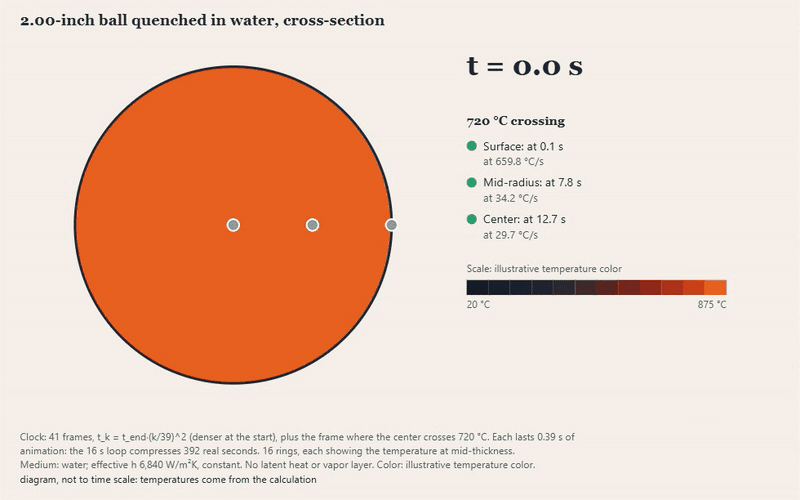

[Versión en español](README.md)

# tratamientos-termicos (heat treatments)

Heat treatments of white cast irons and steels, implemented **from the literature** and validated against measurements published in open access. It uses computational thermodynamics (pycalphad) with an open database, with no commercial software.



## Phase 1: destabilization of high-chromium white irons (ASTM A532)

For a composition and a destabilization temperature, the chain calculates:
1. the phase equilibrium with pycalphad and the MatCalc database;
2. the Ms of the austenite (Andrews 1965);
3. the martensite that forms on cooling (Koistinen and Marburger 1959);
4. the retained austenite and the carbides.

```python
from tratamientos import destabilize

r = destabilize({"C": 2.9, "CR": 18.9, "MN": 1.5, "CU": 1.5, "SI": 0.7}, 1000)
print(r.ms_c, r.retained_austenite("volumen"), r.carbides("volumen"))
```

**Validation result: it does not pass the threshold fixed before running.** Only 7 of 16 retained-austenite cases, from 3 papers, fall within ±10 points.
- **It gets the carbides right** for the Cr-only alloys (within 2 points). In those alloys, the retained austenite between 950 and 1,050 °C falls within 8 points, but the agreement depends on a Mn/Cu split that the paper does not publish: it is weak confirmation.
- **It fails** at 900 °C, where precipitation does not reach equilibrium in 1 h.
- **It fails** with 1.8 % Mo: it underestimates the retained austenite by 24 to 31 points.
- **It does not capture** the effect of the quenching medium.

The detail, with each case, is in [docs/fase1-desestabilizacion.md](docs/fase1-desestabilizacion.md) (in Spanish).

## Phase 2: ball quenching

Transient conduction in a sphere with convection: cooling rate at the surface, mid-radius and center as a function of the diameter and the medium, and comparison with a given critical quenching rate.

- It matches the analytical solution to 0.03 % or better.
- **It passes the validation** against steel spheres measured by the NBS in 1925 (public domain): with the coefficient calibrated on the 3/4" sphere, 7 of 11 center cooling rates fall within ±15 %.
- It reproduces the NBS size law: n = 1.68 against 1.75 in water, and 1.35 against 1.40 in oil.
- **Bias:** the large spheres come out 10 to 19 % faster than measured, because the latent heat of the transformation is missing.

See [docs/fase2-temple.md](docs/fase2-temple.md) (in Spanish) and `python ejemplos/temple_bolas.py`.

## Phase 3: furnace charge calculation

Linear programming: the cheapest mix of scrap, returns, pig iron and ferroalloys that gives the target chemistry. It is robust to the composition ranges of each material.

- **It reproduces the study of Mędoń et al. (2023)** on XCr18 high-chromium iron (*Archives of Foundry Engineering*, CC BY): the 19 charges to 0.42 points or better and their prices to the cent.
- It found an erratum in one of those charges.

See [docs/fase3-carga.md](docs/fase3-carga.md) (in Spanish) and `python ejemplos/carga_xcr18.py`.

## Phase 3b: tempering

Hollomon-Jaffe parameter: with the hardness after 1 h tempers, it predicts that of other times.

- **Validated with a ductile iron** from Salas Vicente et al. (2021, *Metals*, CC BY), with data read from its figure: 19 of 36 predictions within ±25 HV. It passes the threshold narrowly.
- Systematic error: it underestimates the hardness of short tempers and overestimates it in long ones.
- It does not apply to high-chromium white irons, which harden when tempered at 450-550 °C.

See [docs/fase3b-revenido.md](docs/fase3b-revenido.md) (in Spanish) and `python ejemplos/revenido_nodular.py`.

## Ball quenching app

A didactic Streamlit app: the ball in cross-section, ring by ring and second by second, with the numbers of the phase 2 model (the color of each ring is the temperature that `quench_sphere` calculates), and the validation against the NBS spheres. It does not calculate hardness. The Quench tab has indicators, an "Operating state" panel (validated range, numerical solution against the analytical series) and three "Try this" experiments with live-computed figures.

**[▶ Try it in the browser](https://tratamientos-termicos-6wqfzanyzyscgjwaexmopu.streamlit.app/?lang=en)** (Streamlit Community Cloud, no sign-up). The app has an Español / English selector at the top of the sidebar; `?lang=en` opens it in English.

```bash
pip install -e ".[app]"
streamlit run app/streamlit_app.py
```

For the cloud, `requirements.txt` is enough (pinned versions, no pycalphad). The controls and the "What data it needs" table come from a single definition, `app/controles.py`; the texts of each language are in `app/textos_es.py` and `app/textos_en.py`.

## Installation

```bash
python -m venv .venv
.venv\Scripts\python -m pip install -e ".[dev]"
curl -L --create-dirs -o tdb/mc_fe_v2.059.pycalphad.tdb https://raw.githubusercontent.com/pycalphad/pycalphad/develop/examples/databases/mc_fe_v2.059.pycalphad.tdb
.venv\Scripts\python -m pytest
```

The `mc_fe_v2.059` database is the MatCalc steel database (TU Wien, E. Povoden-Karadeniz), licensed under [ODbL 1.0](http://opendatacommons.org/licenses/odbl/1.0/). It is not versioned: it is downloaded with the command above.

### When changing code

1. `ruff check . && basedpyright` (~15 s): checks names and types without running anything. basedpyright reports only **new** errors; the 26 earlier ones are in `.basedpyright/baseline.json`.
2. `pytest` (~4 min) before every commit.

The tests that open the app carry `@pytest.mark.app`, but here `pytest -m "not app"` only saves half the time: the slow part is the pycalphad validations, which belong to the package.

## Roadmap

| Phase | Content |
|---|---|
| 1 ✅ | Destabilization: retained austenite and carbides (validated; it is right only in a window) |
| 2 ✅ | Ball quenching: cooling by diameter and medium (validated with the NBS); hardness, against a given critical rate |
| 1b ✅ | Soak time: the RA tends to equilibrium, but the failure with Mo is a discrepancy between two studies of the same laboratory ([docs](docs/fase1b-cinetica.md), in Spanish) |
| 1c ✅ | Extended validation with new RA data: 9 of 18 cases within ±10 points (6 of 6 from tables, 3 of 12 from a digitized figure); it fails with high Mo and at 900 °C ([docs](docs/fase1c-validacion-ampliada.md), in Spanish) |
| 2b ❌ | h depending on surface temperature (Liščić oil shape, one scale factor): it does not close the bias of the large spheres, it worsens it (MAE 11.3 to 33.7 %), and it does not predict the Liščić probe ([docs](docs/fase2b-h-variable.md), in Spanish) |
| 3a ✅ | Furnace charge calculation: reproduces the 19 charges of a published high-chromium iron study ([docs](docs/fase3-carga.md), in Spanish) |
| 3b ✅ | Tempering (Hollomon-Jaffe): passes narrowly with a ductile iron, 19 of 36 within ±25 HV, with a bias by time ([docs](docs/fase3b-revenido.md), in Spanish) |
| Separate ✅ | Non-ferrous pyrometallurgy (Cu and Sn smelting, converting and refining): done in [simulador-procesos](https://github.com/Laxionx/simulador-procesos) |

## License

MIT · Anthony Vera Baldeón. Built with AI-assisted development (Claude Code), with own review and tests.
